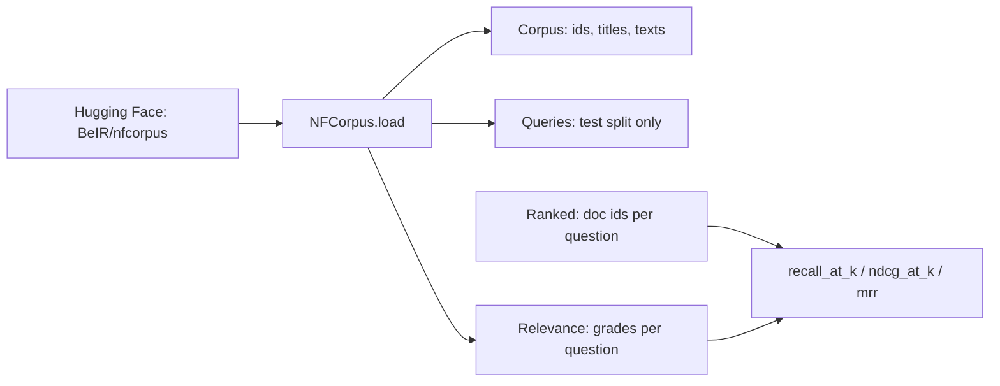

# Stack 1/8: NFCorpus and the ranking metrics

## Summary
This PR loads the task and the scores. NFCorpus has 3,633 medical abstracts and 323 test questions. Each question
has about 38 labeled documents, graded 1 (relevant) or 2 (highly relevant). The PR adds three metrics for a
ranking: Recall@k, NDCG@k and MRR. Every later PR reports these numbers.

## How it works

- [`src/embedding_lab/data/nfcorpus.py:52`](https://github.com/bhavya94/embedding-retrieval-tradeoffs/blob/ef04bb8c7c943fc3d63512ac24f0fa7eb8739bf2/src/embedding_lab/data/nfcorpus.py#L52) loads the corpus, the questions and the labels. It keeps only the
  questions that the chosen split labels.
- [`src/embedding_lab/data/nfcorpus.py:19`](https://github.com/bhavya94/embedding-retrieval-tradeoffs/blob/ef04bb8c7c943fc3d63512ac24f0fa7eb8739bf2/src/embedding_lab/data/nfcorpus.py#L19) joins the title and the abstract into one passage. This passage is
  what gets embedded.
- [`src/embedding_lab/retrieval/metrics.py:22`](https://github.com/bhavya94/embedding-retrieval-tradeoffs/blob/ef04bb8c7c943fc3d63512ac24f0fa7eb8739bf2/src/embedding_lab/retrieval/metrics.py#L22) scores each question on its own. A question without labels gets
  nan, not 0, so it does not pull the mean down.
- [`src/embedding_lab/retrieval/metrics.py:40`](https://github.com/bhavya94/embedding-retrieval-tradeoffs/blob/ef04bb8c7c943fc3d63512ac24f0fa7eb8739bf2/src/embedding_lab/retrieval/metrics.py#L40) computes NDCG with linear gain, the same convention as sklearn.

## Decision log
| Decision | Options considered | Chosen | Why |
|---|---|---|---|
| Dataset | Synthetic docs; MS MARCO; NFCorpus | NFCorpus | Real graded labels, small enough for a laptop, published baselines to check against |
| NDCG gain | Linear; exponential (2^g - 1) | Linear | Matches sklearn and pytrec_eval, so the parity test is exact |
| Unlabeled question | Score 0; nan | nan | A missing label is not a failed retrieval |

## Cost & risk
No model and no API. The first run downloads about 10 MB from Hugging Face.

## Open questions
None.
