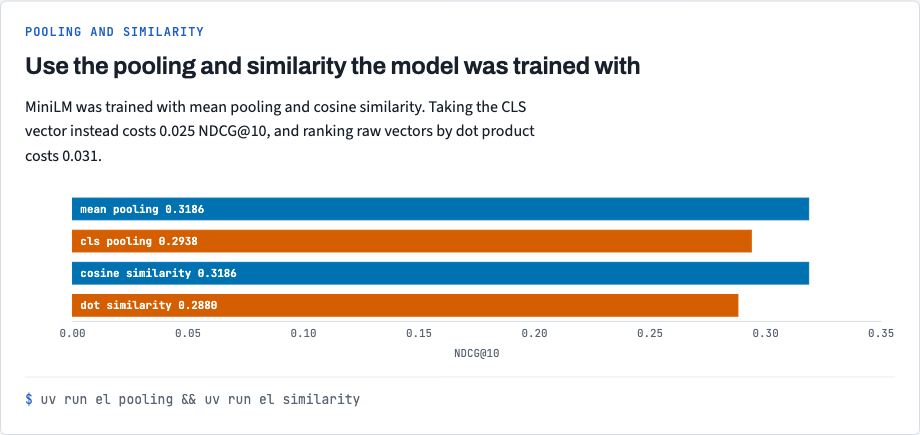
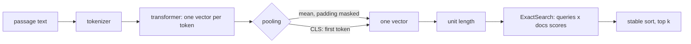

# Stack 2/8: the encoder, pooling, and exact search

## Summary
This PR turns text into vectors and ranks documents by similarity. The pooling step is written out, not hidden
in a library, so mean and CLS pooling can be compared. On NFCorpus, mean pooling scores NDCG@10 0.3186 and CLS
scores 0.2938. Cosine scores 0.3186 and a raw dot product scores 0.2880. Both results follow one rule: use the
pooling and similarity the model was trained with. Every experiment command can also save its numbers as JSON
with `--results-dir`; PR 7 builds a page from those files.

## The experiment, drawn

Mean pooling and cosine similarity, which MiniLM was trained with, score highest. The chart comes from `docs/views/index.html` in the repo.

## How it works

- [`src/embedding_lab/encode/encoder.py:49`](https://github.com/bhavya94/embedding-retrieval-tradeoffs/blob/ec231703031cf89bdcd4a50e0419dd4bf9712924/src/embedding_lab/encode/encoder.py#L49) pools the token vectors. Mean pooling multiplies by the attention mask,
  so padding tokens do not count.
- [`src/embedding_lab/encode/cache.py:17`](https://github.com/bhavya94/embedding-retrieval-tradeoffs/blob/ec231703031cf89bdcd4a50e0419dd4bf9712924/src/embedding_lab/encode/cache.py#L17) saves embeddings on disk. The key hashes the model settings and the texts.
- [`src/embedding_lab/cli.py:29`](https://github.com/bhavya94/embedding-retrieval-tradeoffs/blob/ec231703031cf89bdcd4a50e0419dd4bf9712924/src/embedding_lab/cli.py#L29) writes a command's numbers as JSON when `--results-dir` is set.
- [`src/embedding_lab/retrieval/search.py:37`](https://github.com/bhavya94/embedding-retrieval-tradeoffs/blob/ec231703031cf89bdcd4a50e0419dd4bf9712924/src/embedding_lab/retrieval/search.py#L37) sorts every score with a stable sort. NFCorpus holds 40 duplicate
  abstracts with equal scores, and a stable sort breaks their ties the same way for every k.

## Decision log
| Decision | Options considered | Chosen | Why |
|---|---|---|---|
| Pooling code | sentence-transformers; hand-written | Hand-written, tested against sentence-transformers | The lab is about seeing pooling, not calling it |
| Top-k | argpartition then sort; full stable sort | Full stable sort | argpartition broke ties differently for k=10 and k=100, which moved NDCG by 0.0004 |
| Cache key | Model name; settings and texts | Settings and texts | A changed corpus or setting must never reuse old vectors |

## Cost & risk
MiniLM encodes about 680 texts per second on an M1 GPU. The corpus takes about 6 seconds.

## Open questions
None.
