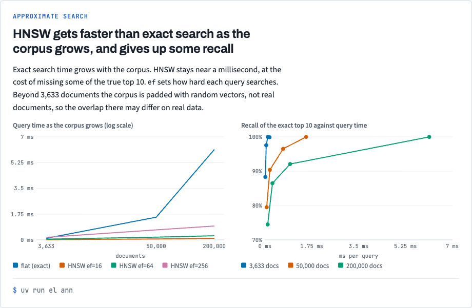
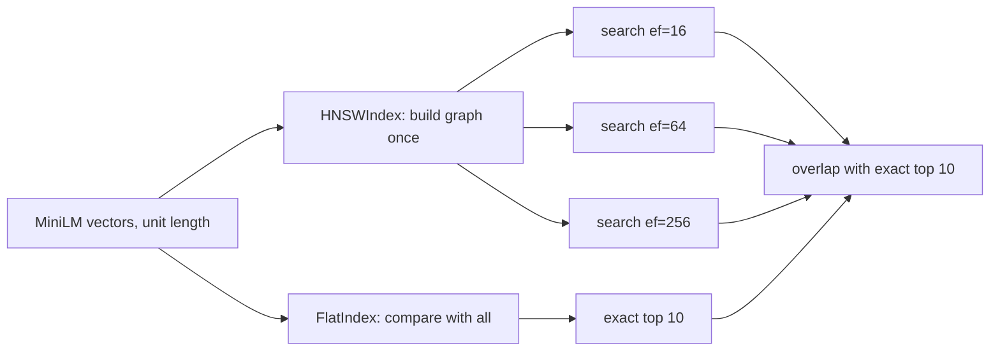

# Stack 3/8: approximate search with FAISS

## Summary
This PR compares exact search with HNSW, a graph index that skips most comparisons. At 200,000 vectors, exact
search takes 6.1 ms per question. HNSW takes 0.3 to 0.9 ms and finds 87% to 92% of the exact top 10. Building
that graph takes about 5.5 minutes on one core. The `ef` setting trades speed for recall at query time.

## The experiment, drawn

Exact search time grows with the corpus; HNSW stays near a millisecond and gives up some of the exact top 10. The chart comes from `docs/views/index.html` in the repo.

## How it works

- [`src/embedding_lab/retrieval/ann.py:61`](https://github.com/bhavya94/embedding-retrieval-tradeoffs/blob/a019204b758274a1164a662abda580bb7c69b26c/src/embedding_lab/retrieval/ann.py#L61) builds HNSW with inner product. On unit vectors, inner product is cosine.
- [`src/embedding_lab/retrieval/ann.py:78`](https://github.com/bhavya94/embedding-retrieval-tradeoffs/blob/a019204b758274a1164a662abda580bb7c69b26c/src/embedding_lab/retrieval/ann.py#L78) changes `ef` without a rebuild, so each corpus size builds one graph.
- [`src/embedding_lab/retrieval/ann.py:18`](https://github.com/bhavya94/embedding-retrieval-tradeoffs/blob/a019204b758274a1164a662abda580bb7c69b26c/src/embedding_lab/retrieval/ann.py#L18) runs each search once untimed before timing it. Without this warm-up,
  the first search looked slower than a deeper one.
- [`src/embedding_lab/__init__.py:7`](https://github.com/bhavya94/embedding-retrieval-tradeoffs/blob/a019204b758274a1164a662abda580bb7c69b26c/src/embedding_lab/__init__.py#L7) sets one OpenMP thread. FAISS and torch each bring an OpenMP runtime on
  macOS, and with both loaded the test suite deadlocked.

## Decision log
| Decision | Options considered | Chosen | Why |
|---|---|---|---|
| Large corpora | Encode more text; pad with random vectors | Random unit vectors | Fits an 8 GB laptop; the README says it is a harder case for HNSW than real data |
| Threads | Default; one | One | Avoids the deadlock and makes latency a single-core number |
| Sizes | Up to 500k; up to 200k | 200k | The 500k build did not finish in 10 minutes |

## Cost & risk
`el ann` takes about 8 minutes, mostly the 200k graph build.

## Open questions
- Product quantization (IVF-PQ) would show the memory side of the trade. Not covered here.
