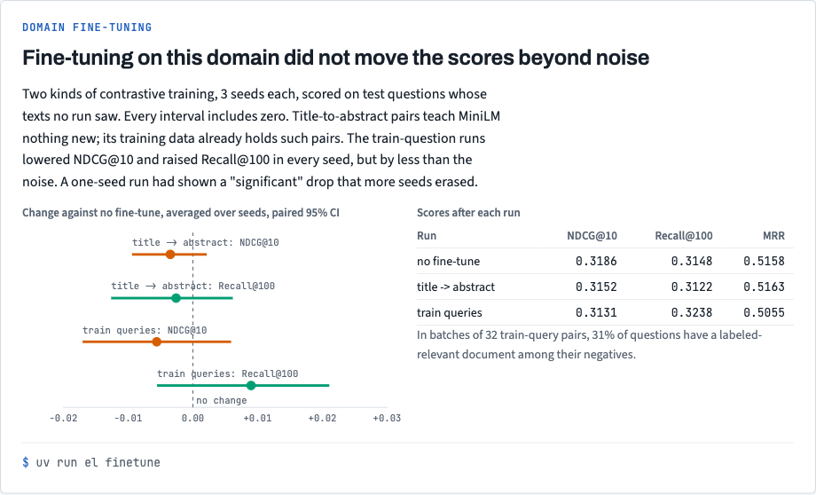
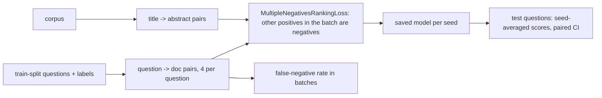

# Stack 4/8: domain fine-tuning

## Summary
This PR tests whether training on the domain helps. Two kinds of contrastive training run 3 seeds each, and
each question's score is averaged over the seeds. Neither moves NDCG@10 or Recall@100 beyond noise: all four
paired 95% intervals include zero. The train-question runs lowered NDCG@10 (about -0.006) and raised
Recall@100 (about +0.009) in every seed, but by less than the variation between questions. A first one-seed
run had reported a drop of 0.0145 with an interval that excluded zero; it did not survive more seeds.

## The experiment, drawn

Every interval includes zero: neither fine-tune moved the scores beyond noise. The chart comes from `docs/views/index.html` in the repo.

## How it works

- [`src/embedding_lab/finetune/contrastive.py:31`](https://github.com/bhavya94/embedding-retrieval-tradeoffs/blob/5ff2d112b85a99ec677ad09bfdf76c8c9ed383af/src/embedding_lab/finetune/contrastive.py#L31) samples up to 4 relevant documents per train question. It
  skips the 3 train questions whose text also appears in the test split.
- [`src/embedding_lab/finetune/contrastive.py:55`](https://github.com/bhavya94/embedding-retrieval-tradeoffs/blob/5ff2d112b85a99ec677ad09bfdf76c8c9ed383af/src/embedding_lab/finetune/contrastive.py#L55) measures how often a batch's negatives hold a document that is
  labeled relevant to the question. Batches are filled like the trainer's, with no repeated question or
  document. In batches of 32, 31% of questions meet one.
- [`src/embedding_lab/finetune/contrastive.py:102`](https://github.com/bhavya94/embedding-retrieval-tradeoffs/blob/5ff2d112b85a99ec677ad09bfdf76c8c9ed383af/src/embedding_lab/finetune/contrastive.py#L102) names each saved model after a hash of its training pairs, so
  changed pairs never reuse an old model.
- [`src/embedding_lab/finetune/contrastive.py:95`](https://github.com/bhavya94/embedding-retrieval-tradeoffs/blob/5ff2d112b85a99ec677ad09bfdf76c8c9ed383af/src/embedding_lab/finetune/contrastive.py#L95) caps texts at 128 tokens. At 256, training ran the 8 GB Mac
  out of memory.
- [`src/embedding_lab/__init__.py:10`](https://github.com/bhavya94/embedding-retrieval-tradeoffs/blob/5ff2d112b85a99ec677ad09bfdf76c8c9ed383af/src/embedding_lab/__init__.py#L10) turns off tokenizer threads. They deadlocked the GPU graph compiler
  during training.

## Decision log
| Decision | Options considered | Chosen | Why |
|---|---|---|---|
| Training pairs | Synthetic only; train-split labels; both | Both | Title pairs test unsupervised adaptation; train labels test supervised adaptation |
| Device | CPU; MPS | MPS at 128 tokens | CPU with one OpenMP thread was about 20 times slower |
| Reporting | Mean only; paired bootstrap CI | Paired CI | A 0.004 change needs an interval before it means anything |
| Seeds | One; three, averaged per question | Three | One seed gave a "significant" result that more seeds erased |

## Cost & risk
On an M1 GPU, one title run takes about a minute and one train-question run about 2.5 minutes, so 3 seeds of
both take about 10 minutes. Models are cached in `.cache/models/`.

## Open questions
- Hard-negative mining that skips labeled-relevant documents could remove the false negatives. Worth one run.
- 323 questions cannot separate effects this small. A larger in-domain test set would.
- Grade-2 labels exist only in the test split, so no run can learn "highly relevant" from this data.
