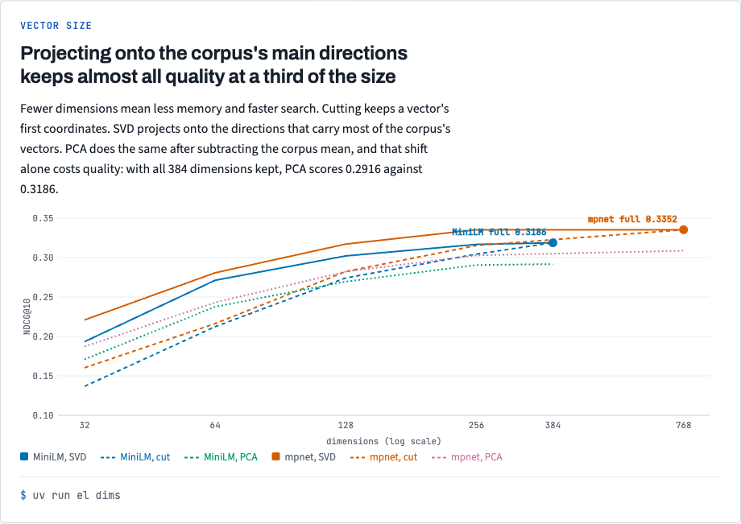
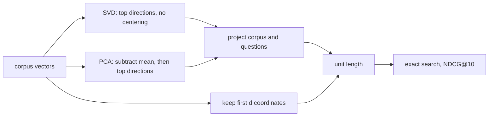

# Stack 5/8: vector size

## Summary
This PR shrinks vectors and measures the loss. Projecting onto the corpus's top singular directions (SVD) beats
centered PCA and cutting at every size. At 256 dimensions SVD keeps 99% of MiniLM's NDCG@10 and all of mpnet's.
mpnet at 128 dimensions scores 0.3170, close to full MiniLM's 0.3186, in a third of the memory. Centered PCA
loses even with every dimension kept: 0.2916 against 0.3186.

## The experiment, drawn

SVD keeps almost all quality at a third of the size; centered PCA loses even at full size. The chart comes from `docs/views/index.html` in the repo.

## How it works

- [`src/embedding_lab/encode/reduce.py:31`](https://github.com/bhavya94/embedding-retrieval-tradeoffs/blob/3aeca65d4deca4a81107ac2936712aa71e80a443/src/embedding_lab/encode/reduce.py#L31) fits SVD or PCA on the corpus vectors only. The questions never shape
  it. PCA subtracts the corpus mean first. That moves the origin, so it changes every cosine similarity even
  when no dimension is dropped.
- [`src/embedding_lab/encode/reduce.py:39`](https://github.com/bhavya94/embedding-retrieval-tradeoffs/blob/3aeca65d4deca4a81107ac2936712aa71e80a443/src/embedding_lab/encode/reduce.py#L39) returns unit vectors, so cosine search stays valid after the cut.

## Decision log
| Decision | Options considered | Chosen | Why |
|---|---|---|---|
| Methods | PCA; SVD; cut | All three | A reviewer found that PCA's centering, not the dimension count, caused its loss; SVD isolates that |
| Second model | bge; mpnet | all-mpnet-base-v2 | Same family and pooling as MiniLM, so only size changes |

## Cost & risk
mpnet encodes the corpus once on an M1 GPU, then the vectors are cached.

## Open questions
- Cutting does better than expected for models not trained for it. Not explained here.
