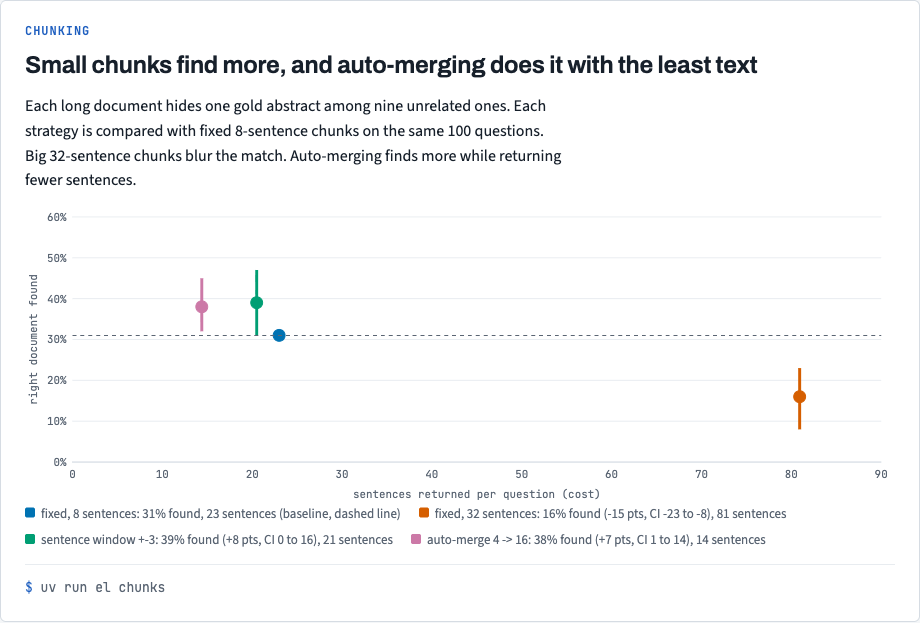
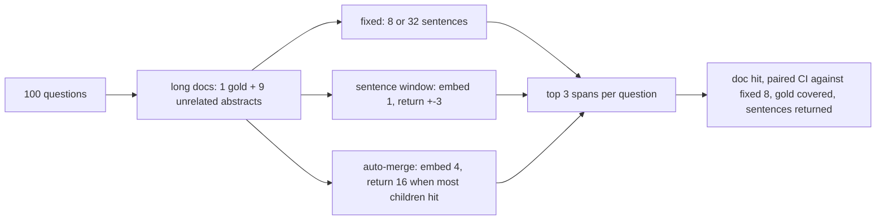

# Stack 6/8: chunking long documents

## Summary
This PR compares three ways to cut long documents. Each test document joins ten abstracts, and one of them is
the best match for a question. Each strategy is compared with fixed 8-sentence chunks on the same 100 questions.
Fixed 32-sentence chunks find the right document 15 points less often, CI [-23, -8]. Auto-merging finds it 7
points more often, CI [+1, +14], and returns 14 sentences per question against 23.

## The experiment, drawn

Small chunks find the right document more often; auto-merging does it with the least text. The chart comes from `docs/views/index.html` in the repo.

## How it works

- [`src/embedding_lab/data/long_docs.py:46`](https://github.com/bhavya94/embedding-retrieval-tradeoffs/blob/a16a36c3ee67e4ab61843fffb640c7d66ec462d6/src/embedding_lab/data/long_docs.py#L46) picks questions so that none is relevant to another question's gold
  abstract. Each question then has exactly one right long document.
- [`src/embedding_lab/data/long_docs.py:61`](https://github.com/bhavya94/embedding-retrieval-tradeoffs/blob/a16a36c3ee67e4ab61843fffb640c7d66ec462d6/src/embedding_lab/data/long_docs.py#L61) keeps filler away from every chosen question's relevant documents, and
  raises an error when there is not enough filler. A first version silently built short documents.
- [`src/embedding_lab/retrieval/chunking.py:28`](https://github.com/bhavya94/embedding-retrieval-tradeoffs/blob/a16a36c3ee67e4ab61843fffb640c7d66ec462d6/src/embedding_lab/retrieval/chunking.py#L28) embeds one sentence but returns its neighbours too.
- [`src/embedding_lab/retrieval/chunking.py:42`](https://github.com/bhavya94/embedding-retrieval-tradeoffs/blob/a16a36c3ee67e4ab61843fffb640c7d66ec462d6/src/embedding_lab/retrieval/chunking.py#L42) replaces child chunks with their parent once more than half of
  them are retrieved. It counts each parent's real children, so a short last parent can merge too.

## Decision log
| Decision | Options considered | Chosen | Why |
|---|---|---|---|
| Test data | Real long papers; stitched abstracts | Stitched abstracts | The gold span is known exactly |
| Report | Separate CIs; paired CI against a baseline | Paired CI | All strategies answer the same questions, so the paired gap is the right test |
| Questions | 200; 100 | 100 | About 130 questions meet the one-right-document rule; 100 leaves enough filler |

## Cost & risk
About 18,800 chunk embeddings on an M1 GPU, then cached.

## Open questions
- The sentence window's interval reaches zero. A larger set could settle it.
