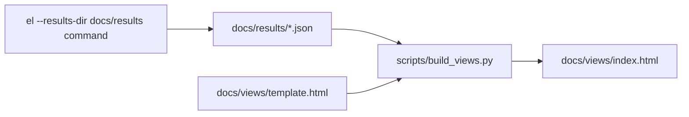

# Stack 7/8: saved results and the results page

## Summary
This PR adds the saved results and a page built from them. Each command wrote its numbers to `docs/results/`
with `--results-dir`. A script turns those files into one self-contained HTML page. The page starts with a
six-step strip that explains the retrieval pipeline, then draws one chart per experiment.

## How it works

- [`scripts/build_views.py:18`](https://github.com/bhavya94/embedding-retrieval-tradeoffs/blob/d156a25dd475186a2da31bcaa6fdf952ca4878fc/scripts/build_views.py#L18) reads only the saved files. The page rebuilds in a second and never reruns a model.
- `tests/test_views.py` fails when the committed page differs from a fresh build.

## Decision log
| Decision | Options considered | Chosen | Why |
|---|---|---|---|
| Page data | Recompute in the build; read saved results | Saved results | The ANN timings vary and fine-tuning takes minutes, so a recompute could not be tested for equality |
| Labels on charts | Inline; legends | Legends | Inline labels collided in four of five charts |
| Chunking whiskers | Separate CIs; paired CI around each point | Paired CI | The page shows the same test the command reports |

## Cost & risk
None beyond the commands themselves. Most of the diff is the generated page.

## Open questions
None.
